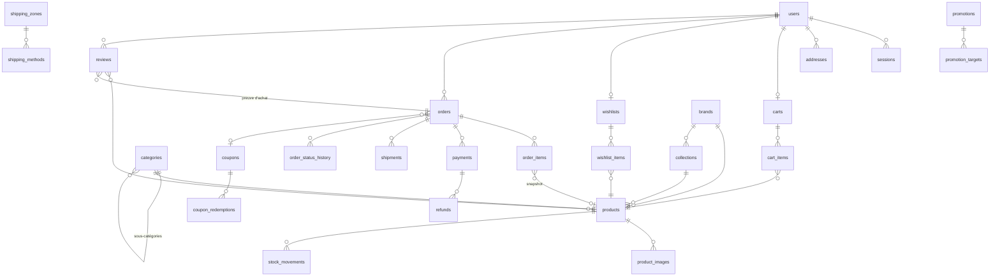

# MAXIGADGET — Backend e-commerce · Étape 1 : conception

> **Mise à jour (octobre 2026)** : pour l'hébergement Namecheap Stellar, la base est passée de PostgreSQL 16 à **MariaDB 11.4**. Les mentions de PostgreSQL ci-dessous (citext, recherche `search_vector`, index partiels) décrivent la conception d'origine ; les adaptations sont détaillées dans `README.md` → « Notes base de données ».

Ce document couvre les 6 premiers points de la méthode : stack, dossiers, schéma, relations, endpoints, authentification/rôles. Le schéma complet est dans `prisma/schema.prisma` (+ `prisma/migrations/0001_init/extra.sql` pour les contraintes CHECK et la recherche).

---

## 1. Stack technique

| Besoin | Choix | Pourquoi |
|---|---|---|
| Runtime / langage | **Node.js 22 LTS + TypeScript strict** | Typage de bout en bout, même langage que le front |
| Framework | **NestJS 11** | Modules, injection de dépendances, guards, pipes, intercepteurs : l'architecture modulaire est imposée par le framework |
| Base de données | **PostgreSQL 16** | Transactions ACID (stock, commandes), CHECK, index partiels, full-text français, trigram |
| ORM | **Prisma 6** | Requêtes paramétrées (pas d'injection SQL), migrations versionnées, types générés |
| Cache / files | **Redis 7 + BullMQ** | Cache catalogue, rate limiting distribué, worker emails et tâches différées |
| Validation | **class-validator + class-transformer** (ValidationPipe global `whitelist`, `forbidNonWhitelisted`) | Rejette tout champ inattendu |
| Auth | **JWT d'accès (15 min) + refresh token opaque en cookie httpOnly** (rotation), **Argon2id** | Voir § 6 |
| Paiement | **Stripe (Payment Intents + webhooks signés)** + Cash on Delivery | Aucune donnée de carte ne touche nos serveurs (SAQ-A) |
| Images | **Cloudinary ou S3** derrière une interface `StorageProvider` | Upload signé direct navigateur → stockage ; seule l'URL est en base |
| Emails | Interface `MailProvider` (Resend par défaut, SendGrid/SES interchangeables) + outbox | Pas d'email perdu si le fournisseur tombe |
| Logs | **Pino** (JSON, `requestId`, masquage des secrets) | Exploitable par Datadog / Loki / CloudWatch |
| Docs | **@nestjs/swagger → OpenAPI 3.1**, servie sur `/api/docs` | Générée depuis les DTO : toujours à jour |
| Tests | **Jest + Supertest + Testcontainers** (Postgres/Redis réels) | Tests d'intégration fiables, sans mocks de la base |
| Sécurité HTTP | Helmet, CORS liste blanche, `@nestjs/throttler` (stockage Redis) | |
| Déploiement | Docker multi-stage, docker-compose (api, worker, postgres, redis) | |

---

## 2. Architecture des dossiers

```
backend/
├── src/
│   ├── main.ts                     # bootstrap : helmet, cors, pipes, swagger, raw body webhooks
│   ├── app.module.ts
│   ├── config/                     # chargement + validation des variables d'env (zod) — l'app refuse de démarrer si une variable manque
│   ├── common/
│   │   ├── decorators/             # @Public(), @Roles(), @CurrentUser()
│   │   ├── guards/                 # JwtAuthGuard (global), RolesGuard, EmailVerifiedGuard
│   │   ├── filters/                # AllExceptionsFilter → format d'erreur unique
│   │   ├── interceptors/           # logging, sérialisation
│   │   ├── pagination/             # PaginationQueryDto, paginate()
│   │   └── utils/                  # money.ts, slug.ts, crypto.ts
│   ├── infrastructure/
│   │   ├── prisma/                 # PrismaService, helper transactions
│   │   ├── redis/                  # client, CacheService
│   │   ├── storage/                # StorageProvider + CloudinaryStorage, S3Storage
│   │   ├── mail/                   # MailProvider + Resend/SendGrid/SES, templates
│   │   └── queue/                  # BullMQ : queues emails, cleanup
│   ├── modules/
│   │   ├── auth/                   # register, login, refresh, logout, verify, forgot/reset
│   │   ├── users/                  # profil, mot de passe, adresses
│   │   ├── catalog/
│   │   │   ├── products/           # CRUD, recherche, filtres, similaires
│   │   │   ├── categories/
│   │   │   ├── collections/
│   │   │   ├── brands/
│   │   │   └── images/             # signature d'upload, rattachement, ordre
│   │   ├── pricing/                # PricingService : prix effectif, promotions, coupons, livraison — source unique de vérité
│   │   ├── inventory/              # réservation / libération de stock, mouvements
│   │   ├── cart/
│   │   ├── wishlist/
│   │   ├── orders/                 # checkout, machine à états, historique
│   │   ├── payments/               # Stripe, COD, webhooks, remboursements
│   │   ├── shipping/               # zones, méthodes, expéditions, suivi
│   │   ├── coupons/
│   │   ├── promotions/
│   │   ├── reviews/
│   │   ├── notifications/          # écoute les événements métier → outbox email
│   │   └── admin/                  # statistiques, dashboard (les CRUD admin vivent dans chaque module)
│   └── worker.ts                   # process séparé : envoi emails, expiration paniers/commandes non payées
├── prisma/  schema.prisma · migrations/ · seed.ts
├── test/    e2e/ · factories/
├── Dockerfile · docker-compose.yml · .env.example
```

Règles :
- **Un module = controller (HTTP) → service (métier) → Prisma.** Les controllers ne contiennent aucune logique.
- Les modules communiquent par services exportés ou par **événements** (`order.paid`, `order.shipped`…) via `@nestjs/event-emitter` ; les notifications ne sont jamais appelées directement par le métier.
- Tous les calculs d'argent passent par `PricingService` (centimes entiers).

---

## 3. Schéma de base de données

29 tables, toutes avec `created_at` / `updated_at`, UUID, clés étrangères et index explicites.

| Domaine | Tables |
|---|---|
| Utilisateurs | `users`, `sessions` (refresh tokens), `user_tokens` (vérification email, reset), `addresses` |
| Catalogue | `brands`, `categories` (arborescence parent/enfant), `collections`, `products`, `product_images`, `stock_movements` |
| Achat | `carts`, `cart_items`, `wishlists`, `wishlist_items` |
| Commandes | `orders`, `order_items`, `order_status_history` |
| Paiement | `payments`, `refunds`, `webhook_events` |
| Livraison | `shipping_zones`, `shipping_methods`, `shipments` |
| Marketing | `coupons`, `coupon_redemptions`, `promotions`, `promotion_targets` |
| Avis | `reviews` |
| Système | `email_outbox`, `audit_logs` |

Décisions clés :
- **Argent en centimes (`Int`)** ; contrainte `total = subtotal + shipping − discount` vérifiée en base.
- **Snapshots de commande** : `order_items` fige nom, SKU, image et prix unitaire ; `orders.shipping_address` fige l'adresse. Modifier un produit ou une adresse n'altère jamais une commande passée.
- **Stock** : colonne `stock` avec `CHECK (stock >= 0)` + journal `stock_movements`. Décrément atomique `UPDATE … SET stock = stock - n WHERE id = ? AND stock >= n` dans la transaction du checkout : pas de survente, même avec des requêtes concurrentes.
- **Caractéristiques techniques en colonnes** (mouvement, couleur, diamètre, étanchéité…) pour pouvoir les filtrer et les indexer ; `extra_specs` (JSON) pour le reste.
- **Popularité** : `sold_count`, `rating_avg`, `rating_count` dénormalisés, mis à jour à la commande payée / à la modération d'un avis → tri sans agrégation.
- **Recherche** : `search_vector` (full-text français pondéré, colonne générée) + index trigram sur le nom.
- **Avis** : `UNIQUE(user_id, product_id)` et `order_id` obligatoire (preuve d'achat d'une commande livrée).
- **Wishlist** : `UNIQUE(wishlist_id, product_id)` → pas de doublon.
- **Webhooks** : `webhook_events.event_id` unique → chaque événement Stripe traité une seule fois.

## 4. Relations principales



---

## 5. Endpoints API (`/api/v1`)

Conventions : JSON, `camelCase`, pagination `?page=&limit=` (max 50), réponses `{ data, meta }`, erreurs `{ statusCode, code, message, details?, requestId }`. 🔓 public · 👤 client connecté · 🛡 admin.

**Auth** — 🔓 `POST /auth/register` · `POST /auth/login` · `POST /auth/refresh` · `POST /auth/verify-email` · `POST /auth/resend-verification` · `POST /auth/forgot-password` · `POST /auth/reset-password` — 👤 `POST /auth/logout` · `POST /auth/logout-all`

**Compte** 👤 — `GET/PATCH /me` · `PUT /me/password` · `GET/POST /me/addresses` · `PATCH/DELETE /me/addresses/:id` · `GET /me/sessions` · `DELETE /me/sessions/:id`

**Catalogue** 🔓 — `GET /products` (recherche + filtres) · `GET /products/:slug` · `GET /products/:slug/similar` · `GET /products/:slug/reviews` · `GET /categories` (arbre) · `GET /categories/:slug` · `GET /collections` · `GET /collections/:slug` · `GET /brands` · `GET /brands/:slug`

Filtres de `GET /products` : `q`, `category`, `brand`, `collection`, `minPrice`, `maxPrice`, `color`, `movement`, `gender`, `inStock`, `onSale`, `isNew`, `featured`, `sort=price_asc|price_desc|newest|popular|rating`, `page`, `limit`.

**Panier** 👤 (ou invité via cookie `cart_token`) — `GET /cart` (lignes, sous-total, réduction, livraison estimée, total, alertes de stock) · `POST /cart/items` · `PATCH /cart/items/:itemId` · `DELETE /cart/items/:itemId` · `DELETE /cart` · `POST /cart/coupon` · `DELETE /cart/coupon` · `POST /cart/merge` (panier invité → compte à la connexion)

**Wishlist** 👤 — `GET /wishlist` · `PUT /wishlist/:productId` (idempotent) · `DELETE /wishlist/:productId`

**Livraison** 🔓 — `GET /shipping/methods?country=FR&subtotal=…`

**Commandes** 👤 — `POST /orders` (checkout, en-tête `Idempotency-Key` obligatoire) · `GET /orders` · `GET /orders/:number` · `POST /orders/:number/cancel` (si PENDING/CONFIRMED)

**Paiements** — 👤 `POST /payments/intent` (crée/renvoie le PaymentIntent Stripe d'une commande) · 🔓 `POST /payments/webhook/stripe` (signature vérifiée, corps brut)

**Avis** — 👤 `POST /products/:slug/reviews` · `PATCH /reviews/:id` · `DELETE /reviews/:id` · `GET /me/reviews/eligible` (produits achetés sans avis)

**Admin** 🛡 (`/admin/...`)
- `products` CRUD · `PATCH products/:id/status` · `POST products/:id/stock` (mouvement) · `POST products/:id/images/sign` · `POST/PATCH/DELETE products/:id/images[/:imageId]`
- `categories`, `collections`, `brands`, `coupons`, `promotions`, `shipping/zones`, `shipping/methods` : CRUD
- `users` (liste, détail, `PATCH :id/role`, `PATCH :id/status`)
- `orders` (liste filtrable, détail, `PATCH :id/status`, `POST :id/shipments`, `PATCH shipments/:id`)
- `payments` (liste, `POST :id/refund`), `orders/:id/cod-collected` (paiement à la livraison encaissé)
- `reviews` (file de modération, `PATCH :id/status`)
- `stats/overview?from&to` (CA, commandes, clients, panier moyen, produits vendus) · `stats/top-products` · `stats/recent-orders` · `stats/low-stock` · `stats/sales-by-day`
- `audit-logs`

Les routes de ton exemple sont conservées. Trois écarts volontaires : `PUT` → **`PATCH`** pour les mises à jour partielles ; les écritures produits passent sous **`/admin`** (la protection est visible dans l'URL et la surface publique reste en lecture seule) ; `/payments/create` → **`/payments/intent`**, et le webhook est suffixé par fournisseur.

---

## 6. Authentification, rôles et sécurité

**Flux**
1. `login` → vérifie Argon2id (mémoire 19 MiB, t=2). Réponse : **access token JWT** (15 min, en mémoire côté front) + **refresh token** opaque de 256 bits dans un cookie `httpOnly; Secure; SameSite=Strict; Path=/api/v1/auth`.
2. En base, seul le **SHA-256 du refresh token** est stocké (`sessions`). À chaque `refresh`, l'ancien token est révoqué et un nouveau est émis (**rotation**). Si un token déjà révoqué est réutilisé, toute la famille est révoquée (vol détecté).
3. `logout` révoque la session ; `logout-all` et le changement de mot de passe révoquent toutes les sessions.
4. Tokens email/reset : 32 octets aléatoires, hashés en base, usage unique, expiration 24 h / 30 min. `forgot-password` répond toujours 202 (pas d'énumération des comptes).

**Rôles** : `CUSTOMER`, `ADMIN`. `JwtAuthGuard` est global (tout est protégé par défaut, `@Public()` pour ouvrir une route) ; `RolesGuard` + `@Roles('ADMIN')` sur tout le contrôleur `/admin`. Le rôle est **relu en base** pour les routes admin (un admin rétrogradé perd l'accès immédiatement). Les ressources client sont toujours filtrées par `userId` du token (un client ne peut pas lire la commande d'un autre, et la réponse est 404, pas 403). Commander exige un email vérifié.

**Règles métier contrôlées uniquement côté serveur**
- Prix : le client n'envoie **que des `productId` et des quantités** ; prix, promotions, coupon, livraison et total sont recalculés par `PricingService`.
- Checkout dans **une transaction** : verrouillage et décrément du stock, validation du coupon (dates, statut, minimum de commande, `max_uses` et `max_uses_per_user` relus sous verrou), création de la commande avec snapshots. Les commandes carte restent PENDING ; sans paiement au bout de 30 min, le worker les annule et restitue le stock.
- Statuts de commande : machine à états explicite (`PENDING→CONFIRMED→PROCESSING→SHIPPED→DELIVERED`, `CANCELLED` depuis PENDING/CONFIRMED, `REFUNDED` après paiement). Chaque transition est historisée.
- Paiement : la commande passe à `PAID` **uniquement via le webhook Stripe signé** (`payment_intent.succeeded`), jamais sur un retour du front. Le montant du webhook est comparé au total de la commande.
- Avis : autorisé seulement si l'utilisateur a une commande `DELIVERED` contenant le produit ; publié après modération.

**Défenses** : Helmet ; CORS restreint à `FRONTEND_URL` ; throttler Redis (global 100 req/min, `login` 5/min par IP+email, `forgot-password` 3/h) ; ValidationPipe strict ; Prisma paramétré ; texte des avis nettoyé (sanitize-html, aucune balise) ; corps limité à 100 kb ; secrets uniquement via les variables d'environnement, validées au démarrage ; logs avec masquage (`password`, `token`, `authorization`, `cookie`) ; journal d'audit pour toutes les actions admin.

---

## 7. Plan d'implémentation

1. ✅ Conception (ce document + schéma)
2. Socle : config/env, Prisma, logger, filtre d'erreurs, pagination, Swagger, Docker, healthcheck
3. Auth + users (+ emails : vérification, reset)
4. Catalogue : marques, catégories, collections, produits, images, recherche et filtres, cache
5. Pricing + inventory + panier + wishlist
6. Livraison + coupons + promotions
7. Commandes (checkout transactionnel, machine à états)
8. Paiements Stripe + COD + webhooks + remboursements
9. Avis + modération
10. Admin : statistiques, audit
11. Tests (auth, produits, panier, commandes, paiement, coupons, permissions), seed, finalisation de la doc OpenAPI
